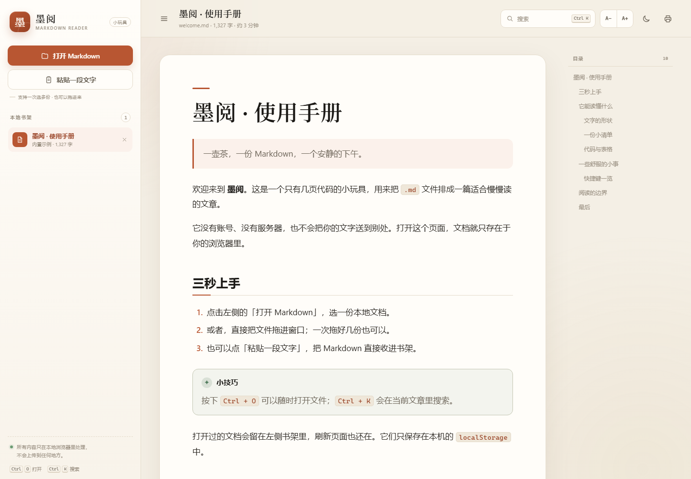
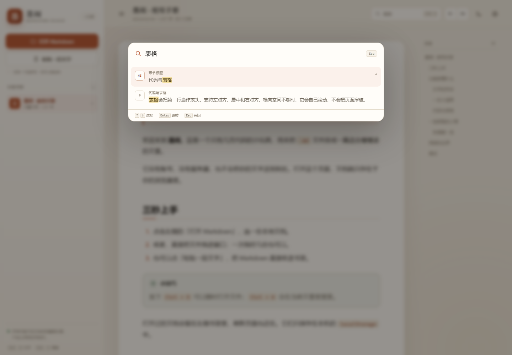
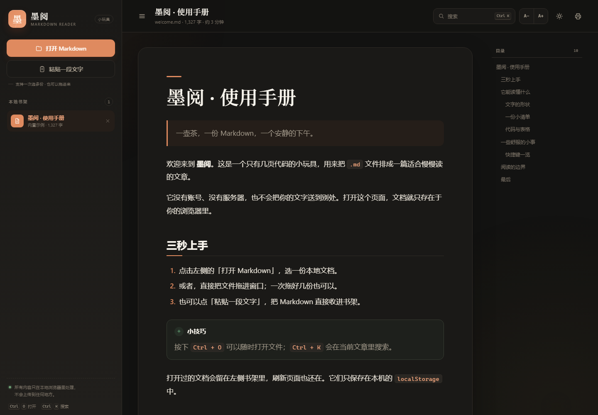
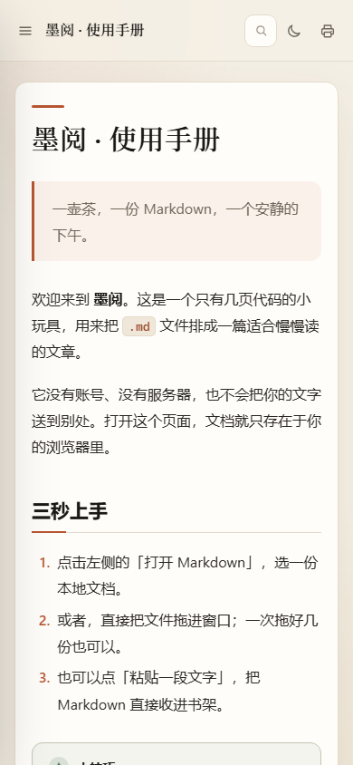
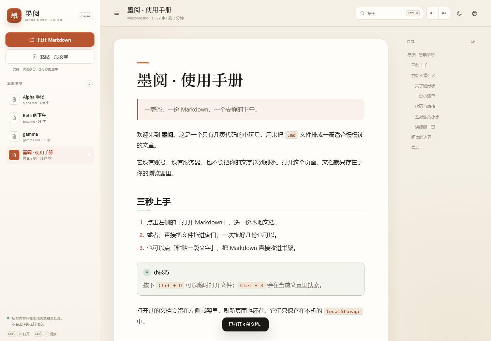
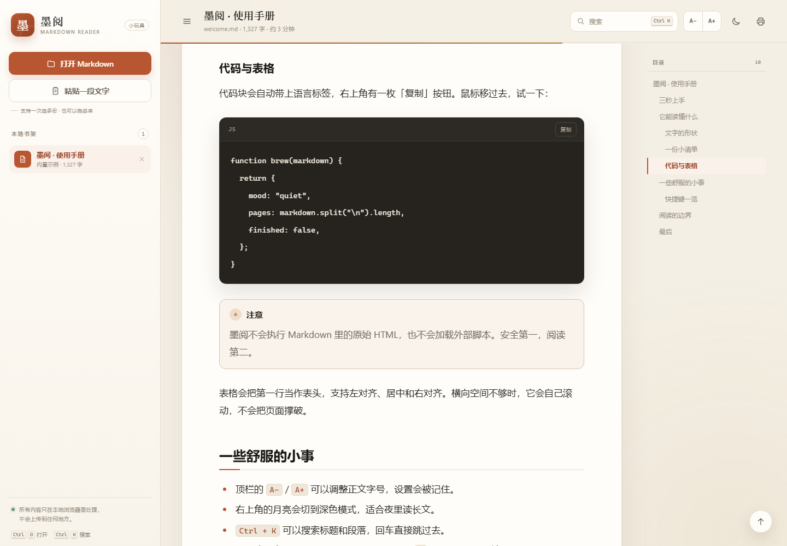

# 墨阅 · 一个 Markdown 小玩具

一壶茶，一份 Markdown，一个安静的下午。

**墨阅**是一个纯静态、零依赖的本地 Markdown 阅读器。打开 `index.html` 就能用，不需要安装、不需要构建，也不会把文档上传到任何地方。



## 快速开始

直接双击 `index.html`，把一份或多份 `.md` / `.markdown` / `.txt` 文件拖进窗口，或者点击「打开 Markdown」多选。

也可以起一个本地静态服务器：

```powershell
cd demo
python -m http.server 8000
```

然后访问 <http://localhost:8000>。

## 它能做什么

- **多文档书架**：一次选择或拖入多份文档，在同一个页面里切换；同名同内容的文件会自动去重，也可以直接粘贴 Markdown。
- **安静地排版**：标题、段落、强调、链接、图片、引用、提示块、列表、任务清单、表格、代码块、分割线、Setext 标题、YAML frontmatter。
- **认出文本**：UTF-8、GBK / GB18030、带 BOM 的 UTF-16 都能读；二进制文件或无法识别的编码会被挡在门外。
- **舒适地读**：自动生成目录、阅读进度、回到顶部、字号调节、明暗主题、打印 / 导出 PDF。
- **找得到**：`Ctrl + K` 搜索标题、段落和代码，回车直接跳转；章节标题旁的 `#` 可以复制小节链接。
- **本地优先**：渲染器不执行原始 HTML，不加载外部脚本；文档内容只写入浏览器本地 `localStorage`。
- **移动端也不挤**：窄屏自动收起书架、隐藏目录，正文保持单栏阅读。

## 再靠近一点

搜索当前文章：



深色主题与手机上的样子：

| 深色主题 | 手机 |
| :---: | :---: |
|  |  |

连续打开多份，在左侧一页页切换：



正文里的代码、表格和任务清单：



## 快捷键

| 快捷键 | 作用 |
| --- | --- |
| `Ctrl + O` | 打开本地 Markdown |
| `Ctrl + K` | 在当前文章里搜索 |
| `Ctrl + B` | 收起 / 展开书架 |
| `Esc` | 关闭弹窗，或收起移动端书架 |

## 项目结构

```text
demo/
├── index.html           # 页面骨架
├── favicon.svg          # 站点图标
├── css/
│   └── style.css        # 主题、排版与响应式样式
├── js/
│   ├── markdown.js      # 零依赖的轻量 Markdown 渲染器
│   ├── sample.js        # 内置示例文档
│   └── app.js           # 书架、搜索、目录、主题等交互
├── preview.png          # 阅读界面
├── preview-dark.png     # 深色主题
├── preview-multi.png    # 多文档书架
├── preview-mobile.png   # 移动端
├── preview-search.png   # 文章内搜索
├── preview-content.png  # 正文排版
├── README.md
└── TESTING.md           # 故障注入与边界测试记录
```

## 关于 Markdown 的边界

这不是完整的 CommonMark 实现，也没有引入 `marked`、`markdown-it` 之类的依赖。它覆盖了日常阅读最常见的语法，并刻意做了这些取舍：

- 原始 HTML 会被当作纯文本转义，避免脚本注入。
- 支持行内链接、自动链接和图片，但不支持引用式链接和脚注。
- 表格支持对齐、行内代码和转义竖线；超宽表格会横向滚动。
- 在 `file://` 下，图片的相对路径可能受浏览器安全限制影响。
- 单份文件建议不超过 8 MB；本地存储不足时会给出提示。

## 一点实现说明

渲染器采用「分块解析 + 行内 token 保护」的方式：

1. 先抽出代码围栏、引用、列表、表格等块级结构。
2. 行内解析时，先把代码、转义字符、链接和图片替换成安全 token，再做强调、删除线和高亮，避免语法互相踩踏。
3. 所有链接协议都会经过白名单检查；生成的 HTML 不包含可执行内容。

UI 层没有框架，使用原生 DOM、原生 `<dialog>` 和 `localStorage`；目录高亮用简单的几何计算完成。样式通过 CSS 变量同时支撑明暗主题。

---

## 测试

多文件打开、拖拽切换、编码识别、异常状态恢复和 Markdown 边界场景的测试记录见 [TESTING.md](TESTING.md)。

---

做这个小玩具，是为了给 Markdown 一个比编辑器更安静的入口。

> 文字不必很多，读得进去就好。
